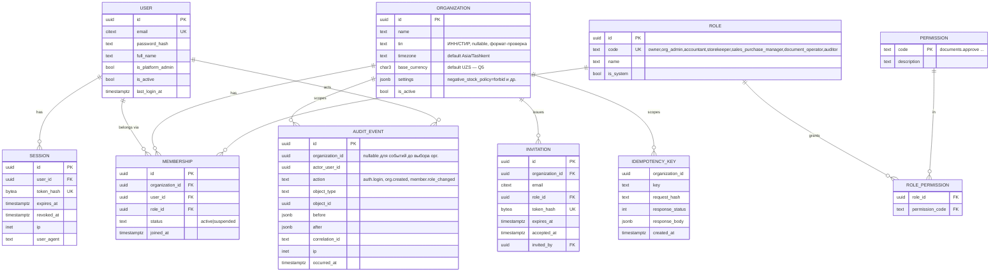

# Hisob AI — Модель данных (ERD)

Статус: **ЧЕРНОВИК**. Часть 1 — подробно (этап 1, будет реализована). Часть 2 — каркас остальных сущностей ТЗ §7 (уточняется перед своим этапом; **бухгалтерская часть не фиксируется до подтверждения бухгалтера**).

Соглашения: PK `id UUID` (UUIDv7 генерируется приложением); `created_at/updated_at TIMESTAMPTZ`; тенантные таблицы имеют `organization_id NOT NULL` + RLS; деньги `NUMERIC(20,4)`, количества `NUMERIC(20,6)` (точность — Q6); валюта `CHAR(3)`; мягкого удаления для учётных данных нет.

## Часть 1. Этап 1 (Foundation)

> **Расхождения реализации с диаграммой (срез 1.1):** таблицы называются `users` и `sessions`; `idempotency_key` привязан к пользователю `(user_id, key)`, а не к организации (создание организации происходит до выбора организации); добавлена `login_attempt` (троттлинг входа); `invitation` добавлена в срезе 1.2 (миграция 0002: токен — только SHA-256, одно действующее приглашение на email в организации, RLS по организации или по владению токеном); RLS включён на `membership` и `audit_event`. Источник истины — миграция `0001_foundation.py`.

### Ограничения и инварианты этапа 1
- `membership (organization_id, user_id)` UNIQUE; в организации всегда ≥1 активный `owner` (проверяется в use case в транзакции с блокировкой строк членства).
- `user.email` уникален без учёта регистра (`citext`). Пароль только `argon2id`-хэш.
- `session.token_hash` — SHA-256 токена; сам токен нигде не хранится.
- `audit_event`: триггеры `BEFORE UPDATE OR DELETE → RAISE EXCEPTION`; роль приложения имеет только `INSERT, SELECT`.
- `role`/`permission`/`role_permission` — глобальные справочники, заполняются миграцией (данные миграции — не демо-данные).
- RLS включён на `membership`, `invitation`, `audit_event`, `idempotency_key` (политика по `app.current_org`); таблицы `user`, `session`, `organization`, `role*`, `permission` — вне RLS, доступ только через сервисы (организации фильтруются по членству пользователя).
- Права (коды) в этапе 1 — минимальный набор: `org.read`, `org.manage`, `members.read`, `members.manage`, `audit.read`. Остальные добавляются вместе с модулями. Матрица «роль × право» — в `docs/05-roadmap.md`, **требует подтверждения владельца (Q8)**.

## Часть 2. Каркас остальных сущностей (не реализуется на этапе 1)

| Этап | Сущности (ТЗ §7) | Ключевые инварианты |
|---|---|---|
| 2 | `Counterparty`, `Product`, `UnitOfMeasure`, `ProductIdentifier`, `Warehouse` | уникальность SKU и ИНН в пределах организации; единицы и коэффициенты явные; ИКПУ — nullable строка без выдуманной валидации |
| 3 | `Document`, `DocumentFile`, `DocumentLine`, `ExtractedField`, `DocumentRelation`, `AIJob`, `AIResult`, `ApprovalRequest` | `UNIQUE(organization_id, sha256)` для dedup; поле = `{value, confidence, evidence, validation_status}`, неизвестное = `NULL`; хранится версия модели и шаблона |
| 4 | `StockMovement`, `StockReservation`, `StockCount` | движения append-only; остаток = агрегат движений (проверка расхождения тестом); проведение документа — `UNIQUE(source_document_id, kind)` против повторов; блокировка строки остатка при списании |
| 5 | `AccountingPeriod`, `ChartOfAccount`, `JournalEntry`, `JournalLine`, `PostingBatch`, `AccountingRule/TaxRule` | **дебет = кредит** (CHECK через deferred-триггер на уровне записи); закрытый период блокирует вставку; сторно — новая запись со ссылкой; правила версионируются (`version`, `effective_from/to`, `status`, `legal_basis`). **Содержание правил/счетов/проводок НЕ проектируется без бухгалтера (Q9)** |
| 6 | `BankAccount`, `BankStatement`, `BankTransaction`, `ReconciliationMatch` | `UNIQUE(org, account, external_ref/hash)` для идемпотентного импорта; match хранит причины и автора решения |
| 7 | `IntegrationConnection`, `IntegrationSyncRun`, `WebhookEvent` | секреты зашифрованы; статус `NOT_CONFIGURED|MOCK|CONNECTED`; курсор синхронизации; журнал запусков |
| 8 | `Conversation`, `Message`, `ToolCall` (дополнение к ТЗ) | каждый tool-вызов логируется с организацией, правами и источниками |
| 3+ | `Notification` | по пользователю и организации |

Что не определено ТЗ и **не выдумывается**: конкретный план счетов, шаблоны проводок, ставки/правила налогов (НДС и др.), метод оценки запасов (FIFO vs средневзвешенная — «по утверждённой учётной политике»), формат выписок конкретных банков, схемы API Multibank/Faktura.uz/Didox.
